<div align="center">


# Sabeel · سبيل

**Pothole detection and management for Tunisia.**
A citizen snaps a photo, an AI grades the pothole, the law decides who must fix it, and everyone can see when it's done.


</div>

---

## Why

About 20,000 km of classified roads, thousands of km of city streets, and no shared register of the damage on them. Potholes are reported by phone call, letter or Facebook post: no location, no severity, no follow-up. A road repaired late costs **6 to 8 times** more than one maintained early ([FHWA](https://www.fhwa.dot.gov/publications/focus/98jun/068pm.cfm)).

Sabeel ("the way") closes the gap between *a pothole appears* and *it is fixed, and the citizen knows it*.

## How it works

| | Step | What happens |
|---|---|---|
| 📸 | **Snap** | One tap in the app, or a phone browser with nothing to install, or hands-free while driving. No account. |
| 🧠 | **Score** | YOLO11s finds the pothole and grades it 1–5 on a plain CPU (~0.1 s). No pothole seen? The citizen can retake or send anyway. |
| 🛡️ | **Protect** | Faces and number plates are blurred and GPS metadata stripped before any photo is stored. |
| 📍 | **Confirm** | Reports within 5 m merge into one pothole (PostGIS); it is confirmed when **two different phones** back it ("I see it too" counts). |
| 🗺️ | **Route** | OpenStreetMap tells which road it is: national and regional roads go to the regional directorate of equipment (Law 86-17), city streets to the municipality (Law 2018-29, art. 69). |
| 📝 | **Write** | A RAG agent drafts the work order and cites only real texts: the law plus the FHWA repair manual. One invented citation and the draft is discarded. |
| ✅ | **Approve** | An officer reviews, edits and approves it; the PDF carries a QR code that proves it wasn't altered. |
| 🔧 | **Fix** | The officer marks it fixed with a proof photo, and **the AI re-checks the photo**. Citizens confirm "well repaired" or reopen it with "still there". |
| ⏱️ | **Escalate** | Deadlines by severity (48 h for a 5); overdue twice over, the pothole moves up to the parent office. |
| 📊 | **Show** | A public page shows counts, repair times, the worst streets and a live map. |

## What makes it different

- **The AI checks the repair, not just the report.** A proof photo that still shows a pothole is flagged.
- **Law-based routing that is right where intuition is wrong.** Avenue Habib Bourguiba in Tunis is tagged RN9: legally a national road, so it goes to the DGPC, not the city ([20-point verification](backend/app/geo/README.md)).
- **Work orders that can't be faked.** SHA-256 fingerprint and QR code on every PDF, checkable by anyone.
- **Rain-aware priority.** A free 48 h forecast raises serious potholes before the rain hides them.
- **Today's repair tour.** One click orders the top potholes into a driving route (OSRM).
- **Driving mode with voice alerts.** The phone on the windscreen reports potholes by itself and says "Attention, nid-de-poule dans 150 mètres".
- **Explainable priority.** Every score is a sum of named points (severity, road, citizens, age, overdue, reopened, rain).
- **Street health index** for budget decisions, on the dashboard and the public page.
- **Every correction trains the model.** "Not a pothole" clicks and approved sheets become labelled data.

## The mobile app

One-tap capture with undo, offline-proof uploads with retries, a status tracker with notifications, a live clustered map with "I see it too", and the driving mode. [Details](mobile/README.md).

<p align="center">
  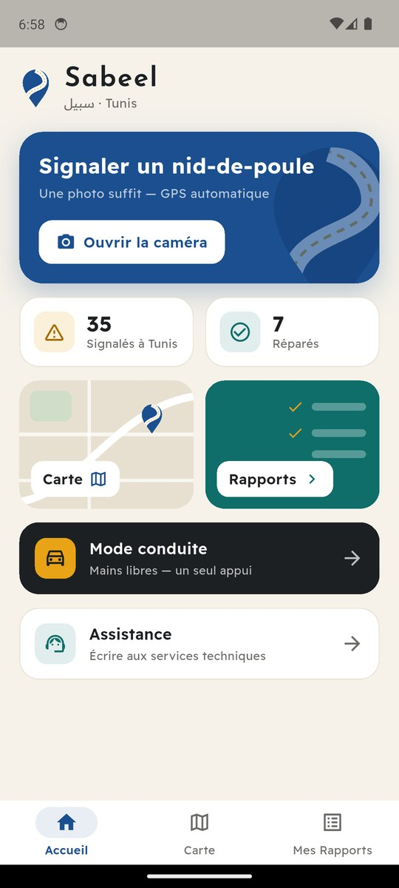
  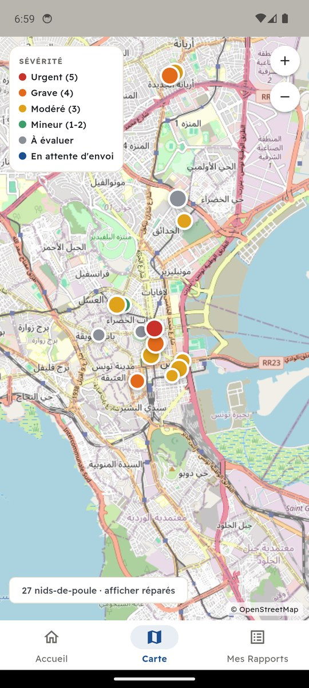
  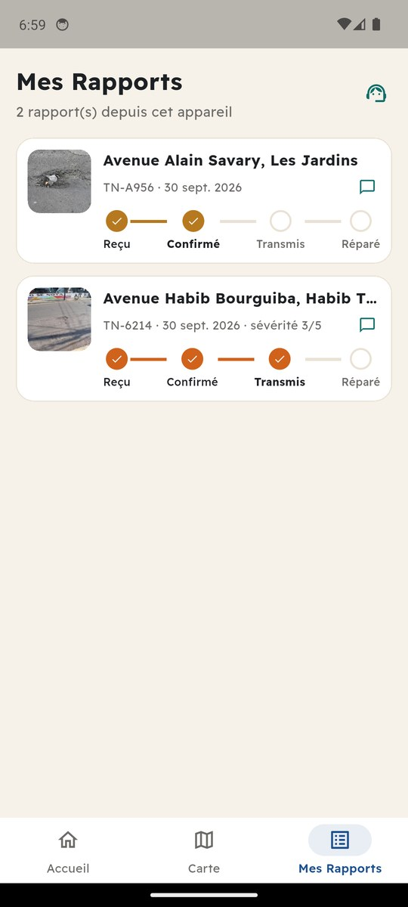
  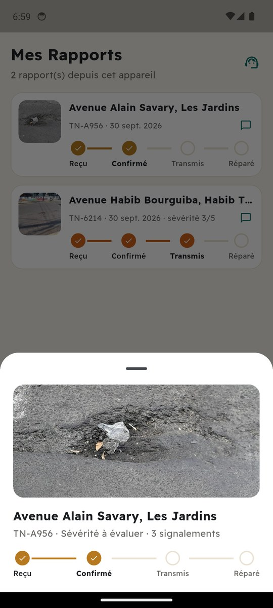
  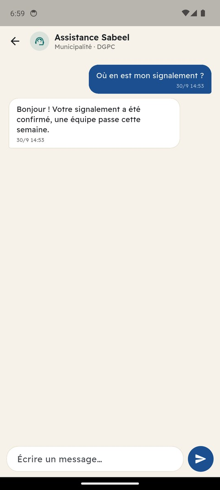
</p>

## The authorities dashboard

For municipalities, regional directorates of equipment and the ministry, each seeing only its own potholes. [Details](dashboard/README.md).

<p align="center">
  
  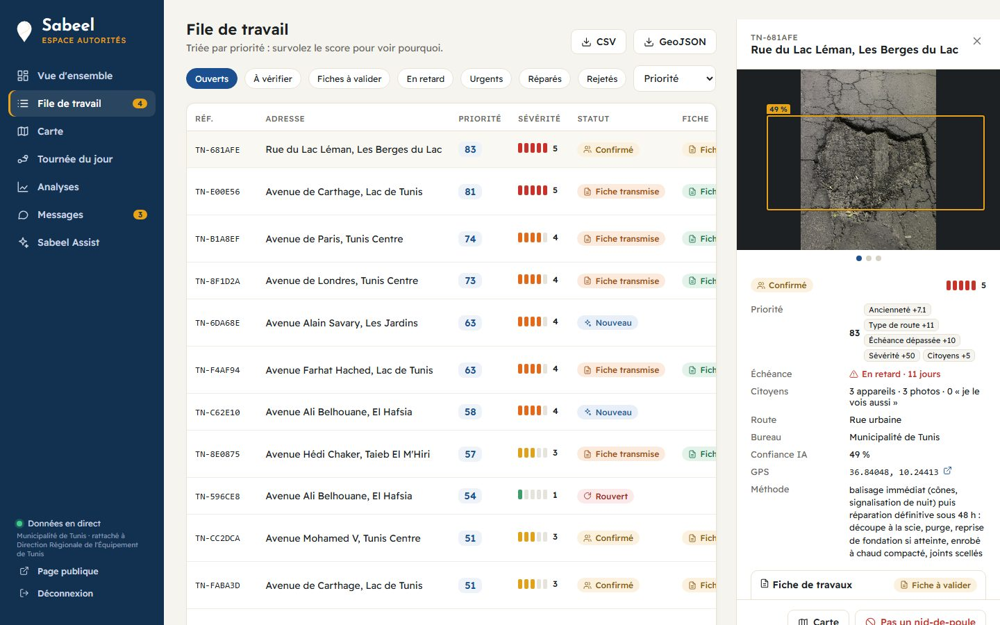
</p>
<p align="center">
  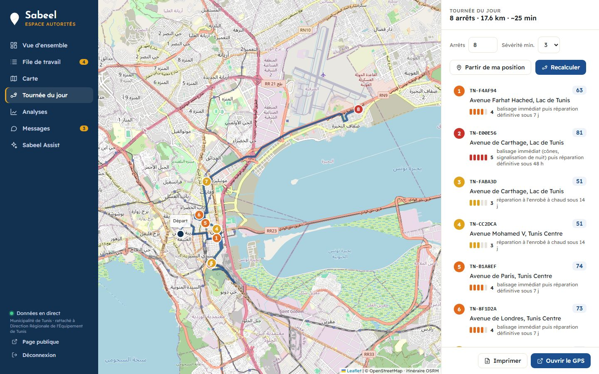
  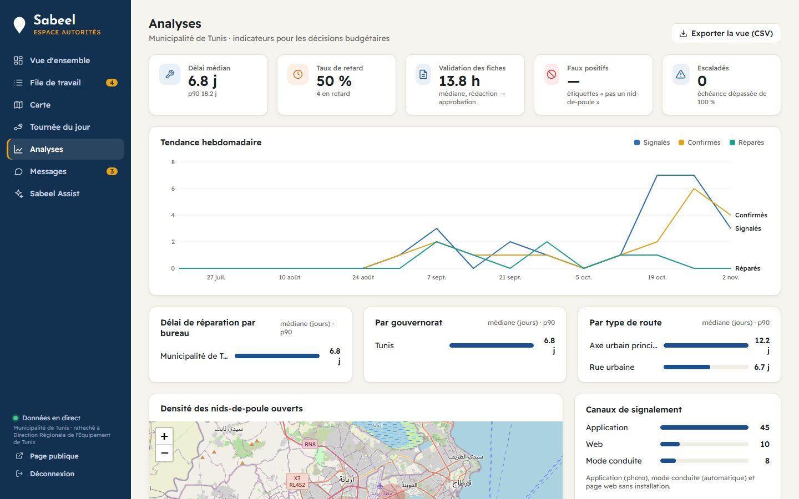
</p>

**Sabeel Assist** answers questions in French, Arabic or English from the office's live data and cites pothole references you can open on the map.

## The public site

No login, no install: report from any phone browser (works offline, installable), track a report, verify a work order, and see the numbers.

<p align="center">
  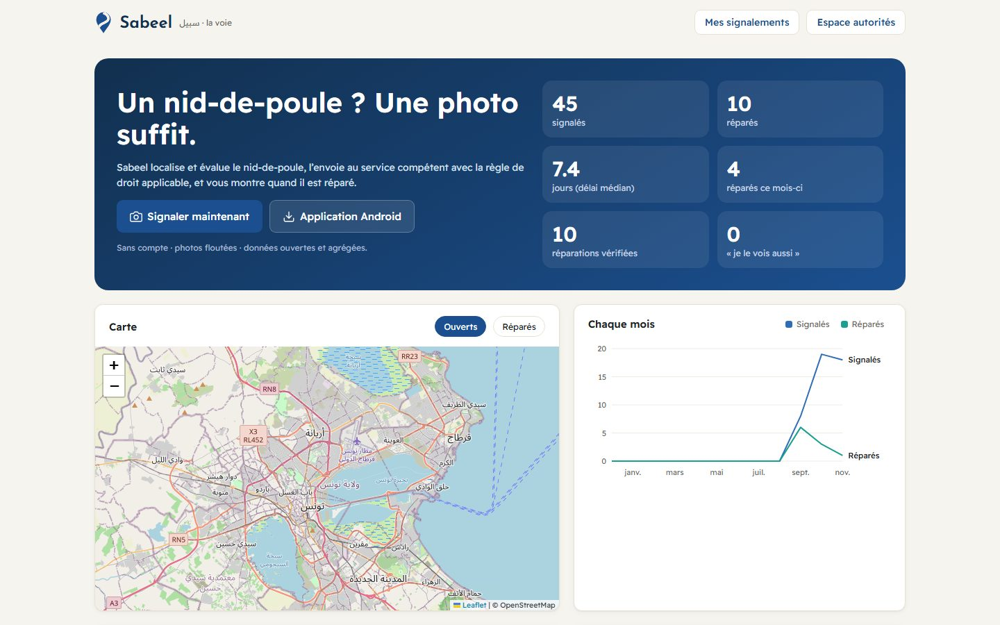
  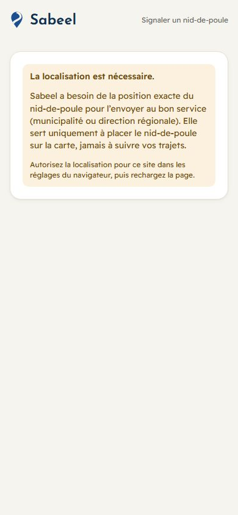
</p>

## The AI

**Detection.** YOLO11s trained on RDD2022 potholes (6 countries), close-up photos and pothole-free roads, served with ONNX Runtime on a CPU. Test split (686 images): **mAP50 0.562**, precision 0.62, recall 0.54. That is below the 0.75 target; [`MODEL_REPORT.md`](ml-training/MODEL_REPORT.md) says why and what comes next (Tunisian test set, error analysis, INT8 for a bigger model). Severity v2 uses separate size bands for close-up photos and dashcam frames.

**Work orders.** Multilingual MiniLM embeddings in Chroma retrieve the rules for the road's owner and the pothole's severity; an open-weight LLM writes the sheet; every citation is checked against what it was shown. The corpus is 15 real rules: Law 2018-29, Law 86-17, and the FHWA pothole-repair manual of practice (FHWA-RD-99-168) translated into French. [Details](rag-service/README.md).

## Architecture

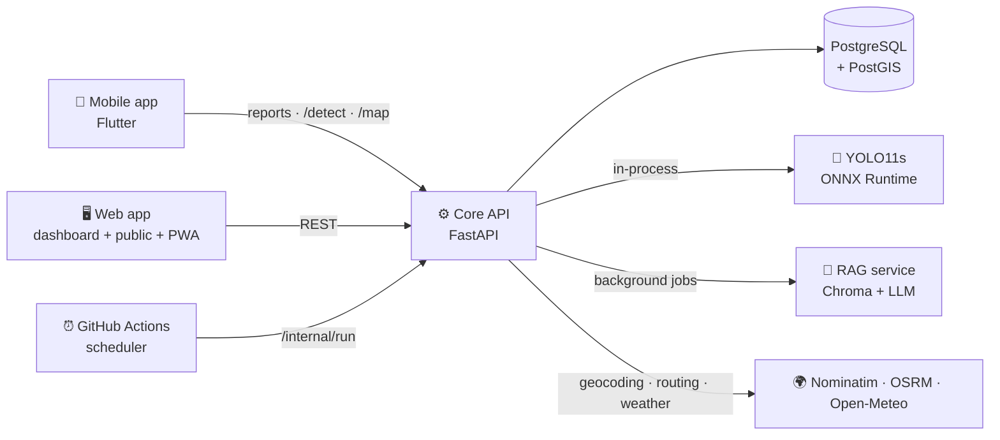

| Component | Folder | Stack |
|---|---|---|
| Mobile app | [`mobile/`](mobile) | Flutter, flutter_map (OpenStreetMap) |
| Web app (dashboard, public site, PWA) | [`dashboard/`](dashboard) | React, TypeScript, Vite, Leaflet |
| Core API | [`backend/app`](backend/app) | FastAPI, SQLAlchemy, PostgreSQL + PostGIS, numbered SQL migrations |
| Vision model | [`ml-training/`](ml-training) | YOLO11s, ONNX Runtime (CPU) |
| RAG service | [`rag-service/`](rag-service) | Chroma, sentence-transformers, any OpenAI-compatible LLM |

## Quick start

You need PostgreSQL 16 with PostGIS, Python 3.12, Node 20+ and Flutter (or `docker compose up -d`).

```bash
cp .env.example .env                                  # set DATABASE_URL
pip install -r backend/app/requirements.txt
python -m uvicorn backend.app.main:app --port 8000    # applies migrations on startup
python -m backend.app.seed                            # demo data, real Tunis streets and photos

cd rag-service && uvicorn app.main:app --port 8001    # LLM credentials in rag-service/.env
cd dashboard && npm install && npm run dev            # http://localhost:5173
cd mobile && flutter run --dart-define=API_BASE_URL=http://10.0.2.2:8000
```

Dashboard demo logins: `demo-mun-tunis`, `demo-dre-tunis`, `demo-ministry`.

**Deploy for free in about 30 minutes:** one Hugging Face Space (API, RAG and web app in one container) plus Supabase (database and photos). No credit card. Step by step: [`docs/DEPLOYMENT.md`](docs/DEPLOYMENT.md).

## Quality

| | |
|---|---|
| Core API | 105 tests on an isolated PostGIS database, no network (OSM answers recorded) |
| RAG | 18 tests, no LLM or index needed |
| Web | typecheck, Vitest (contract and offline queue), build |
| Mobile | `flutter analyze` clean, 35 tests |
| ML | severity self-check, model smoke test |
| End to end | `python -m backend.app.scripts.e2e_smoke` walks the whole demo path |

Measured locally: report round trip **0.4–0.75 s** (target < 3 s), inference **114 ms** (target < 250 ms), every dashboard endpoint < 0.3 s on 5,000 potholes.

## Documentation

[Cahier des charges](docs/Cahier_de_charges.md) · [Deployment](docs/DEPLOYMENT.md) · [Core API](backend/app/README.md) · [OSM routing](backend/app/geo/README.md) · [Model report](ml-training/MODEL_REPORT.md) · [RAG](rag-service/README.md) · [Mobile](mobile/README.md) · [Web](dashboard/README.md) · [Sprint 1 contracts](docs/Sprint1_Action_Plan.md)

## Team

| Work package | Lead | Co-lead |
|---|---|---|
| WP1 — AI detection model | [@tharaaoueslati-lang](https://github.com/tharaaoueslati-lang) | [@jasseurchibani](https://github.com/jasseurchibani) |
| WP2 — RAG agent & work sheet | [@AymenJeddou](https://github.com/AymenJeddou) | [@JedBelhaj](https://github.com/JedBelhaj) |
| WP3 — Core API & geospatial backend | [@jasseurchibani](https://github.com/jasseurchibani) | [@tharaaoueslati-lang](https://github.com/tharaaoueslati-lang) |
| WP4 — Mobile app (citizen & driving mode) | [@JedBelhaj](https://github.com/JedBelhaj) | [@AymenJeddou](https://github.com/AymenJeddou) |

## Workflow (Agile / Scrum)

1. **No direct pushes to `main` or `dev`.** Every change goes through a pull request and a review.
2. **Branch from `dev`**, named by type and topic (`feature/…`, `fix/…`, `chore/…`), and open the PR against `dev`.
3. **`main` is demo-ready only.** `dev` merges into `main` at the end of a sprint; every push to `main` deploys.
4. **One review per PR, CI green before merge, one issue per PR** (`Closes #N`).
5. **Contracts:** exact field names, `lat` before `lon`, UTC timestamps with a trailing `Z`, new settings in `.env.example`, new tables as a new numbered migration.

<div align="center">
<sub>Built in Tunisia by Aymen Jeddou, Tharaa Oueslati, Jasseur Chibani and Jed Belhaj Mohamed · 2026</sub>
</div>
