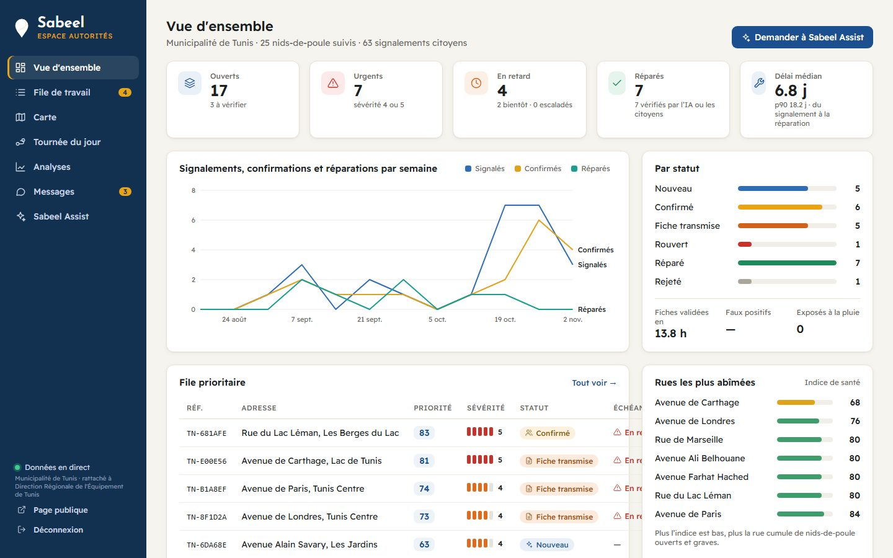
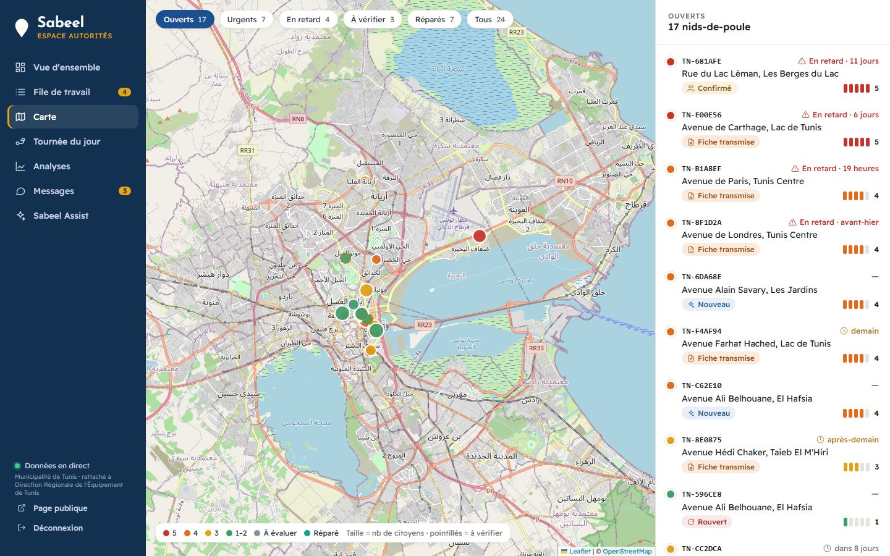
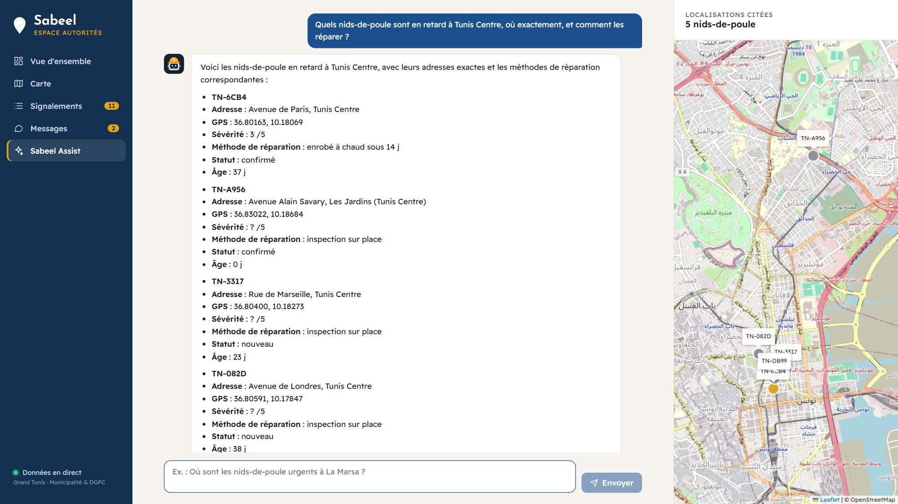
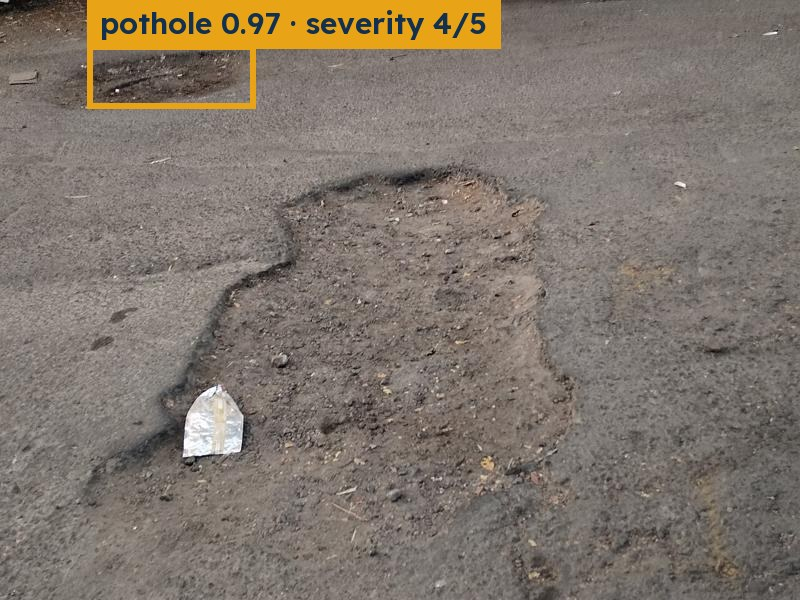
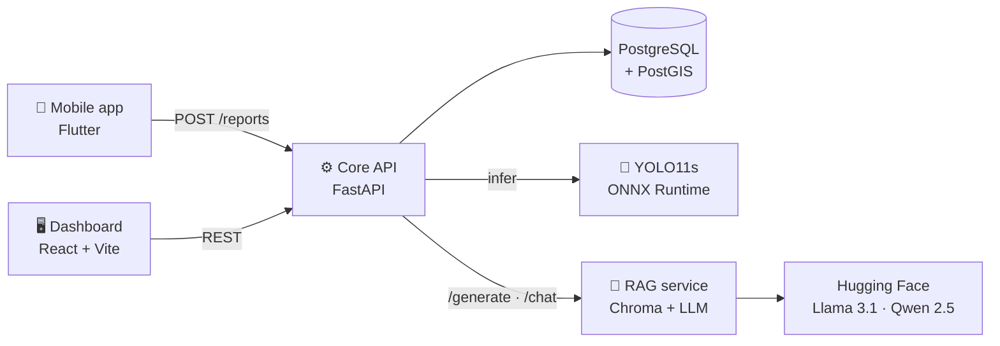

<div align="center">


# Sabeel · سبيل

**Pothole detection and management for Tunisia.**
A citizen snaps a photo, an AI grades the pothole, and a repair order that quotes the law lands on the right desk.


</div>

---

## Why

About 20,000 km of classified roads, thousands of km of city streets, and no shared register of the damage on them. Potholes are reported by phone call, letter or Facebook post: no location, no severity, no follow-up. Meanwhile a road repaired late costs **6 to 8 times** more than one maintained early ([FHWA](https://www.fhwa.dot.gov/publications/focus/98jun/068pm.cfm)).

Sabeel ("the way") closes the gap between *a pothole appears* and *a repair order is sent*.

## How it works

| | Step | What happens |
|---|---|---|
| 📸 | **Snap** | A citizen takes a photo. GPS, speed and heading are attached. No account. |
| 🧠 | **Score** | A YOLO11s model finds the pothole and grades severity 1–5 on a plain CPU (≈ 240 ms). |
| 📍 | **Confirm** | Two reports within 5 m merge into one confirmed pothole (PostGIS). |
| 📝 | **Write** | For severity ≥ 3 a RAG agent drafts the work order and cites the real law. |
| 🏛️ | **Route** | The order goes to the baladiya or the DGPC depending on the road type. |
| ✅ | **Close** | The authority marks it fixed and the citizen sees it on their phone. |

## The mobile app

For citizens and drivers. One tap to report, a live map of the city, and a status tracker for every report.

<p align="center">
  
  
  
  
  
</p>

- Anonymous device id, no personal data (Law 2004-63)
- Offline queue, retried automatically
- Support chat whose messages land in the authorities' inbox
- Animated splash, Arabic and French typefaces bundled

## The authorities dashboard

For the baladiya technical services, the DGPC and the Ministry of Equipment.

<p align="center">
  
  
</p>

- **Overview**: open / urgent / overdue / repaired KPIs, weekly trend and a priority queue with deadlines (48 h for severity 5, 7 days for 4)
- **Map**: every pothole as a case file with photo, citizens, deadline, office and the RAG work order; confirm, repair or reject in one click
- **Signalements**: searchable table with CSV export
- **Messages**: inbox for the citizens' support chat with quick replies

### Sabeel Assist

An AI assistant for the technical service. Ask in French, Arabic or English; it answers only from the live database, cites pothole references you can open on the map, and follows the repair playbook for each severity.

<p align="center">
  
</p>

## The AI

<table>
<tr>
<td width="45%"></td>
<td>

**Detection** — YOLO11s trained for 100 epochs on RDD2022 potholes (6 countries), close-up pothole photos and pothole-free roads, exported to ONNX and served with ONNX Runtime on a CPU. On 686 held-out test images: **mAP50 0.56**, precision 0.62, recall 0.54 ([details](ml-training/README.md)). Severity comes from the size of the box.

**Work orders** — a RAG agent retrieves the matching rules (multilingual MiniLM embeddings in Chroma), an open-weight LLM writes the sheet, and every citation is checked against what it was shown. One bad citation and the draft is replaced by a template built from the real excerpts. Legal base: Loi organique 2018-29 (art. 69) and Loi 86-17.

</td>
</tr>
</table>

## Architecture



| Component | Folder | Stack |
|---|---|---|
| Mobile app | [`mobile/`](mobile) | Flutter, flutter_map (OpenStreetMap) |
| Authorities dashboard | [`dashboard/`](dashboard) | React, TypeScript, Vite, Leaflet |
| Core API | [`backend/app`](backend/app) | FastAPI, SQLAlchemy, PostgreSQL + PostGIS |
| Vision model | [`ml-training/`](ml-training), [`backend/vision`](backend/vision) | YOLO11s, ONNX Runtime (CPU) |
| RAG service | [`rag-service/`](rag-service) | Chroma, sentence-transformers, Hugging Face Inference |

## Quick start

You need PostgreSQL 16 with PostGIS, Python 3.12, Node 20+ and Flutter.

```bash
# 1. Database: create "roadscan", apply backend/app/db/schema.sql, set DATABASE_URL in .env

# 2. RAG service (needs HF_API_TOKEN in rag-service/.env)
cd rag-service && python -m uvicorn app.main:app --port 8001

# 3. Core API, from the repo root
python -m uvicorn backend.app.main:app --port 8002

# 4. Demo data: real Tunis streets, real pothole photos, sample conversations
python -m backend.app.seed

# 5. Dashboard → http://localhost:5173
cd dashboard && npm install && npm run dev

# 6. Mobile app (phone over USB: adb reverse tcp:8002 tcp:8002)
cd mobile && flutter run --dart-define=API_BASE_URL=http://127.0.0.1:8002
```

Each component's README has the details: [`mobile`](mobile/README.md) · [`dashboard`](dashboard/README.md) · [`backend/app`](backend/app/README.md) · [`ml-training`](ml-training/README.md) · [`rag-service`](rag-service/README.md). Shared environment variables are listed in [`.env.example`](.env.example).

## Team

| Work package | Lead | Co-lead |
|---|---|---|
| WP1 — AI detection model | [@tharaaoueslati-lang](https://github.com/tharaaoueslati-lang) | [@jasseurchibani](https://github.com/jasseurchibani) |
| WP2 — RAG agent & work sheet | [@AymenJeddou](https://github.com/AymenJeddou) | [@JedBelhaj](https://github.com/JedBelhaj) |
| WP3 — Core API & geospatial backend | [@jasseurchibani](https://github.com/jasseurchibani) | [@tharaaoueslati-lang](https://github.com/tharaaoueslati-lang) |
| WP4 — Mobile app (citizen & driving mode) | [@JedBelhaj](https://github.com/JedBelhaj) | [@AymenJeddou](https://github.com/AymenJeddou) |

Full specification: [`docs/Cahier_de_charges.md`](docs/Cahier_de_charges.md) · Sprint plan and data contracts: [`docs/Sprint1_Action_Plan.md`](docs/Sprint1_Action_Plan.md). Each sprint's tasks are tracked as GitHub Issues, one per work package.

## Workflow — how we work (Agile / Scrum)

This repo follows a strict branch/PR workflow. It applies to everyone, including maintainers.

1. **No direct pushes to `main` or `dev`.** All changes go through a pull request and a review, no exceptions.
2. **Branch from `dev`, not `main`.** Name your branch by type and topic, e.g. `feature/wp2-rag-chunking`, `fix/api-dedup-bug`, `chore/ci-cache`.
3. **Open your PR against `dev`.** `dev` is the integration branch — this is where all work packages meet.
4. **`main` is protected and reserved for stable, reviewed, demo-ready code only.** `dev` merges into `main` only at the end of a sprint, once the sprint's Definition of Done is met.
5. **Every PR needs at least one review** from another team member (ideally your work package's co-owner) before merging.
6. **Keep PRs small and scoped** to one task or one issue — easier to review, easier to revert.
7. **Reference the issue you're closing** in your PR description (e.g. `Closes #4`).
8. **CI must be green before merge.** A broken `dev` blocks everyone.
9. **Use exactly the field names and shapes defined in the data contracts** (`docs/Sprint1_Action_Plan.md`, Section 4) — a locally renamed field is the most common source of integration bugs across work packages.
10. **All timestamps are UTC, ISO 8601, with a trailing `Z`.**

```bash
git checkout dev && git pull
git checkout -b feature/<short-description>
# ... work, commit ...
git push -u origin feature/<short-description>
# open a PR: base = dev, compare = feature/<short-description>
```

<div align="center">
<sub>Built in Tunisia by Aymen Jeddou, Tharaa Oueslati, Jasseur Chibani and Jed Belhaj Mohamed · September 2026</sub>
</div>
