<div align="center">

# CAHIER DES CHARGES

## RoadScan — Pothole Detection & Management System (Tunisia)

**Projet Fédérateur — Cycle Ingénieur (CI3)**

*A mobile app, an AI detection model, a live map and a RAG agent that turns a citizen's photo into a repair work order.*

| | |
|---|---|
| **Document** | Cahier des charges (functional & technical specification) |
| **Version** | 5.0 — aligned with the repository structure |
| **Date** | September 2026 |
| **Duration** | 4 weeks (4 one-week sprints) |
| **Budget** | 0 TND — free-tier services only |
| **Team** | Aymen Jeddou · Tharaa Oueslati · Jasseur Chibani · Jed Belhaj Mohamed |
| **Intended readers** | Academic supervisors, municipalities, DGPC, Ministry of Equipment and Housing |
| **Companion documents** | [`README.md`](../README.md) · [`Sprint1_Action_Plan.md`](Sprint1_Action_Plan.md) |

</div>

---

## Document control

| Version | Date | Change |
|---|---|---|
| 4.0 | Sept 2026 | Initial "simple version" of the specification |
| 5.0 | Sept 2026 | Restructured to mirror the repository (work packages WP1–WP4, WP-T); architecture decisions taken during Sprint 1 recorded (RAG as separate service, `manual` / `driving_mode` sources, contracts frozen); UML diagrams added; implementation status added for every feature |

**How to read the status markers used throughout this document**

| Marker | Meaning |
|---|---|
| ✅ Done | Implemented in the repository and covered by tests or a runnable demo |
| 🟡 Partial | Skeleton or stub exists; behaviour incomplete |
| ⬜ Planned | Specified, not started |

---

## Table of contents

1. [Introduction and context](#1-introduction-and-context)
2. [Objectives and measurable targets](#2-objectives-and-measurable-targets)
3. [Stakeholders and actors](#3-stakeholders-and-actors)
4. [Scope](#4-scope)
5. [Functional requirements](#5-functional-requirements)
6. [Use case model](#6-use-case-model)
7. [Non-functional requirements](#7-non-functional-requirements)
8. [System architecture](#8-system-architecture)
9. [Dynamic behaviour](#9-dynamic-behaviour)
10. [Data model](#10-data-model)
11. [Interface contracts](#11-interface-contracts)
12. [Work packages and repository structure](#12-work-packages-and-repository-structure)
13. [Technology choices](#13-technology-choices)
14. [Data, privacy and legal compliance](#14-data-privacy-and-legal-compliance)
15. [Quality assurance, CI/CD and deployment](#15-quality-assurance-cicd-and-deployment)
16. [Project plan](#16-project-plan)
17. [Risk analysis](#17-risk-analysis)
18. [Acceptance criteria](#18-acceptance-criteria)
19. [Appendices](#19-appendices)

---

## 1. Introduction and context

### 1.1 Problem statement

Tunisia has roughly 20,000 km of classified roads (national, regional, local) plus thousands of kilometres of city streets. Their surface degrades quickly for three reasons:

- **Heat** — summers above 45 °C followed by heavy autumn rain crack the surface.
- **Water** — water enters the cracks and weakens the base layer; a pothole can appear within days.
- **Slow, unstructured reporting** — potholes are reported by phone, letter or social media, with no common format, no exact location and no follow-up.

> **Rationale.** A pothole repaired early costs far less than one left for months. The fastest lever on cost is therefore to shorten the delay between *"pothole appears"* and *"repair order issued"*. This is the single idea RoadScan implements.

### 1.2 Existing solutions and positioning

| Approach | Strength | Limitation |
|---|---|---|
| Survey vehicles with cameras | Accurate | Expensive, low coverage frequency |
| Generic complaint apps | Cheap, easy | No automatic grading, no structured output |
| Research AI detectors | Good detection | Stop at detection — no repair order |
| **RoadScan** | Cheap crowd reporting + automatic severity grading + rule-grounded work sheet | Depends on citizen adoption; MVP scope |

RoadScan combines the low cost of crowd reporting, the automatic grading of AI detectors and, as its differentiating step, converts a GPS point into a work sheet that **quotes the applicable legal rule** through a Retrieval-Augmented Generation (RAG) agent.

### 1.3 Project one-liner

> *photo → score → deduplicated map dot → rule-cited work sheet → routed to the right office → status tracked until fixed.*

---

## 2. Objectives and measurable targets

### 2.1 General objectives

| # | Objective | Description |
|---|---|---|
| O1 | **Capture** | Obtain a photo (citizen) or a video frame (driving phone) with GPS, heading and speed |
| O2 | **Detect** | Detect potholes and grade severity 1–5 with an open YOLOv8n model running on CPU |
| O3 | **Write the sheet** | Turn a confirmed serious pothole into a work order through a RAG agent grounded on real texts |
| O4 | **Show the map** | Display all reports on one live map, merged by proximity and prioritised |

### 2.2 Measurable targets

| Indicator | Target | Measured on |
|---|---|---|
| Model accuracy (mAP@50) | ≥ 0.75 | Held-out test set |
| Detection latency | < 250 ms | One photo, CPU |
| Time to report (open app → done) | < 15 s | Real-device test |
| Full report round trip (no RAG) | < 3 s | API + DB |
| Work-sheet generation time | < 20 s | RAG service |
| Sheets rated "ready to use" | ≥ 90 % | Human review |
| Duplicate-merge distance | < 5 m | PostGIS query |
| Driving-mode runtime | ≥ 20 min | Phone as dashcam |
| Monthly infrastructure cost | 0 TND | Free plans only |

> **Rationale.** 0.75 mAP is the level at which the model is useful as a filter. 250 ms keeps a request cheap on a free CPU tier. 15 s is roughly how long a person will stand next to a pothole to report it. 5 m matches typical urban smartphone GPS accuracy.

---

## 3. Stakeholders and actors

| Actor | Role | Main expectation |
|---|---|---|
| **Citizen / driver** | Sees the pothole first | Report in < 15 s, no account |
| **Volunteer driver** | Drives with the phone on the windscreen | Automatic reports, low battery use |
| **Municipality (baladiya)** | Manages city streets | Ready-to-use, sorted, rule-cited sheets |
| **DGPC** | Manages national / regional roads | One combined view by road and region |
| **Ministry of Equipment** | Plans and funds road works | Consolidated, duplicate-free data |

---

## 4. Scope

### 4.1 In scope (MVP)

- Photo reporting with GPS, heading, speed (F1) and offline queue.
- Map with filters and proximity-based deduplication (F2).
- RAG work-sheet generation with cited rules (F3).
- Priority list per office and status workflow (F4).
- Citizen feedback on own reports without an account (F5).
- Hands-free driving mode (F6).
- Export as CSV / GeoJSON.

### 4.2 Out of scope

| Excluded item | Reason |
|---|---|
| Accounts, profiles, points, leaderboards | No login keeps reporting friction minimal |
| Dedicated dashcam hardware | 0 TND hardware budget |
| Direct integration into municipal IT systems | Files only for the MVP |
| Automatic repair cost estimation | Separate project |
| App-store publication | An APK is sufficient for the demo |
| Motorways (`A`, Tunisie Autoroutes) | Different managing body |

---

## 5. Functional requirements

Six features (F1–F6) are specified below. Each has a user story, functional rules, acceptance criteria and an implementation status reflecting the repository.

### 5.1 Feature summary

| ID | Feature | Owner WP | Status |
|---|---|---|---|
| F1 | Photo capture & report | WP4 (app), WP1 (score), WP3 (API) | 🟡 Partial |
| F2 | Map with filters & deduplication | WP3, WP4 | 🟡 Partial |
| F3 | Work-sheet generation (RAG) | WP2, WP3 | 🟡 Partial |
| F4 | Priority list & status workflow | WP3, WP4 | 🟡 Partial |
| F5 | Citizen feedback on own reports | WP4, WP3 | 🟡 Partial |
| F6 | Hands-free driving mode | WP4, WP1 | ⬜ Planned |

### 5.2 F1 — Photo capture and report

*As a citizen, I take a photo of a pothole and the app captures my exact position and grades it without me typing anything.*

**Rules**
- On capture the app sends: photo, `lat`, `lon`, `gps_accuracy_m`, `speed_kmh`, `direction_deg`, `captured_at` (UTC), `source`, and a phone-generated `device_report_id`.
- The vision model returns a whole-number `score` 1–5 and a `confidence` 0–1.
- Above about 40 km/h a manual photo is likely blurred; the report is flagged for review instead of being rejected.
- Without network, the report is stored in a local queue and uploaded later; the `device_report_id` is never regenerated.
- Without GPS permission the app explains why the permission is needed.

**Severity scale**

| Score | Meaning | Colour | System behaviour |
|---|---|---|---|
| 1 | Small crack / hole | Green | Counted only |
| 2 | Low severity | Green | Counted, alert if clustered |
| 3 | Medium | Orange | Sheet generated once confirmed |
| 4 | High | Orange | Sheet generated, repair soon |
| 5 | Serious / dangerous | Red | Sheet generated, urgent |

> **Implementation note.** The score is computed by `score_from_detections()` in [`ml-training/severity_scoring.py`](../ml-training/severity_scoring.py) from the *relative area* of the largest confident bounding box (thresholds 0.5 %, 1.5 %, 4 %, 8 % of the image), with +1 for confidence > 0.85. Pothole depth in millimetres cannot be measured from a single 2-D photo, so the depth-based table of earlier versions is used only as a semantic description of each level, not as a computation rule.

**Acceptance criteria**
1. Photo and location reach the API in one request.
2. `score` is an integer in [1, 5] and `confidence` in [0, 1].
3. An offline report is delivered after connectivity returns, exactly once.
4. Open app → report sent takes less than 15 s.

**Status:** 🟡 capture screens, preview, result screen, GPS/heading reading and the offline-queue repository exist in [`mobile/lib`](../mobile/lib); the API stores reports and runs ONNX inference ([`backend/app/routers/reports.py`](../backend/app/routers/reports.py)). Automatic queue flushing on reconnection is still to be wired.

### 5.3 F2 — Map with filters and deduplication

*As a city officer, I open a map, see problem spots at a glance and never see the same pothole twice.*

**Rules**
- Full-screen OpenStreetMap; each pothole is a dot coloured by score.
- If a new report lies within **5 m** of an existing one, both share a `cluster_id` and the state moves from `new` to `confirmed`.
- The proximity test runs **in the database** (PostGIS `ST_DWithin` on a GiST index), never on the phone.
- `GET /map` returns the reports in the current viewport as a flat list; tapping a dot shows the record.
- Filters: score, status, region; clustering of markers by zoom level for 5,000+ points.

**Acceptance criteria**
1. Two reports 3 m apart share the same `cluster_id` and are `confirmed`.
2. Two reports 30 m apart stay independent.
3. The map remains fluid with 5,000+ points.

**Status:** 🟡 deduplication ([`dedup.py`](../backend/app/dedup.py)) and `GET /map?bbox=` ([`routers/map.py`](../backend/app/routers/map.py)) are done; map screen with `flutter_map` exists; `sev` / `state` filters and marker clustering are planned.

### 5.4 F3 — Work-sheet generation (RAG)

*As a technical manager, a confirmed serious pothole becomes a real work order routed to the right office with the applicable rules quoted.*

**Trigger.** Automatic, when `status = confirmed` **and** `score ≥ SCORE_THRESHOLD_FOR_SHEET` (default 3). No user action.

**Processing (RAG service)**
1. Determine the road type (`urbain_principal`, `urbain_secondaire`, `rural`, `autoroute`, `piste`).
2. Retrieve the top-5 matching rule chunks from Chroma (multilingual embeddings), discarding matches below a similarity floor.
3. Build a prompt that forces the LLM to cite a rule identifier for every claim and to answer "not enough rules" when nothing matches.
4. Call the primary LLM (Llama 3.1 8B Instruct), fall back to the backup (Qwen 2.5 72B Instruct), then to a deterministic template if output is invalid.
5. A citation guard rejects any citation that does not exist in the retrieved set.
6. Return `sheet_text`, `rule_citations`, `target_office`, `road_type`.

> **Rationale.** A fixed template cannot adapt to road type or quote the right rule; an unconstrained LLM can invent rules — unacceptable in an official document. RAG restricts the model to real text, and every line stays traceable to its source.

**Acceptance criteria**
1. Every sheet cites at least one real, retrievable rule.
2. `target_office` is never empty and belongs to {Municipality, DGPC, Ministry of Equipment}.
3. A sheet is produced in under 20 s.
4. A generation failure never blocks report creation: the report stays `confirmed` and is retried.

**Status:** 🟡 pipeline, retrieval, citation guard, fallback template and tests exist under [`rag-service/`](../rag-service); rule corpus currently combines `rules_real` (Law 2018-29 CCL, Law 86-17) with `rules_placeholder` files pending full legal review. Current API integration is a synchronous HTTP call inside `POST /reports`; migration to a background task is planned for Sprint 3.

### 5.5 F4 — Priority list and status workflow

*As a city, I want a sorted list of what I must fix and a button to mark it done.*

**Rules**
- Each office sees only its own potholes, sorted by urgency × traffic × age.
- Status moves strictly forward: `new → confirmed → sheet_sent → fixed`. Any other transition is rejected with **HTTP 409**.
- Every change is time-stamped (`updated_at`); the list is exportable as CSV / GeoJSON.

**Acceptance criteria**
1. `PATCH new → fixed` returns 409.
2. `PATCH confirmed → sheet_sent` returns 200 and updates `updated_at`.
3. The exported file contains the same rows as the on-screen filtered list.

**Status:** 🟡 state machine and `PATCH /reports/{report_id}` done with tests ([`status.py`](../backend/app/status.py), [`tests/test_status.py`](../backend/app/tests/test_status.py)). `report_events` history table, per-office queue and export endpoints are planned.

### 5.6 F5 — Citizen feedback

*As a driver, I want to know my report was seen and whether it has been fixed.*

- No account. The phone stores the `device_report_id` of each report it created.
- `GET /reports/{device_report_id}` returns `status`, `score`, `sheet_summary`.
- A local notification appears when a tracked report becomes `fixed`.

> **Rationale.** All data is donated by citizens; proof that reporting has an effect is the only lasting incentive.

**Status:** 🟡 endpoint done; "My reports" screen exists ([`reports_screen.dart`](../mobile/lib/screens/reports_screen.dart)) on mock data; polling and notification planned.

### 5.7 F6 — Hands-free driving mode

*As a driver, I put the phone on the windscreen and the app finds and reports potholes on its own.*

**Rules**
- Frames are sampled from the camera stream at a fixed low rate (target 1 frame/s; final value fixed after the Sprint 3 blur/battery test).
- A pothole is reported only after **3 consecutive positive frames**.
- Capture is suspended when the vehicle is stationary and above **80 km/h**.
- Reports use `source = driving_mode` and follow the same deduplication as F2.
- Empty frames are discarded and never uploaded; full trips are never stored.

**Acceptance criteria**
1. Runs 20+ minutes without crash or overheating.
2. Only confirmed detections are uploaded.
3. Driving-mode reports appear on the same map as manual ones.

**Status:** ⬜ planned (Sprint 3).

---

## 6. Use case model

### 6.1 Use case diagram

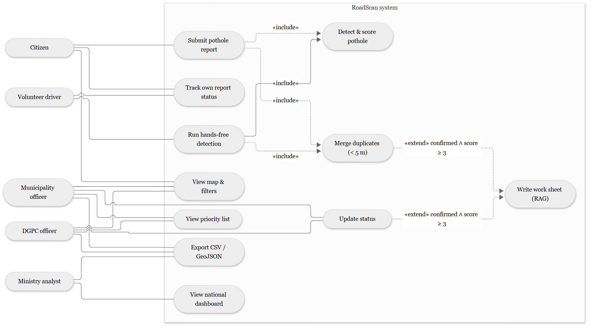

*Source: [`diagrams/src/use_case.mmd`](diagrams/src/use_case.mmd)*

**Reading notes.** No user ever triggers "Write work sheet" directly: it is an automatic extension that runs when a pothole becomes confirmed with a score of at least 3. "Track own report status" is shared by citizens and volunteer drivers because a dashcam report belongs to the phone exactly like a manual photo.

### 6.2 Actor–feature matrix

| Actor | F1 | F2 | F3 | F4 | F5 | F6 | Export |
|---|:-:|:-:|:-:|:-:|:-:|:-:|:-:|
| Citizen | ● | ○ | | | ● | | |
| Volunteer driver | | ○ | | | ● | ● | |
| Municipality | | ● | ● | ● | | | ● |
| DGPC | | ● | ● | ● | | | ● |
| Ministry | | ● | | ○ | | | ● |

● main user · ○ read-only

---

## 7. Non-functional requirements

| Category | ID | Requirement | Target | Rationale |
|---|---|---|---|---|
| Performance | NFR-1 | Full report round trip without RAG | < 3 s | Feels instant |
| Performance | NFR-2 | ONNX inference on CPU | < 250 ms | Free-tier compute |
| Performance | NFR-3 | Cold-start first call | < 4 s | Scale-to-zero trade-off |
| Scalability | NFR-4 | Auto-scaling | 0 → 80 instances | Storm peaks |
| Cost | NFR-5 | Monthly cost | 0 TND | Project constraint |
| Security | NFR-6 | HTTPS, input validation and rate limiting on every route | 100 % routes | No login → strict validation needed |
| Privacy | NFR-7 | No personal data; faces/plates blurred before storage | Before persistence | Law 2004-63 |
| Portability | NFR-8 | Container-based, no vendor lock-in | Dockerfile per service | Easy migration |
| Observability | NFR-9 | Health endpoints, structured logs | Always on | Debuggability |
| Accessibility | NFR-10 | Contrast and large touch targets | WCAG 2.1 AA | Outdoor sun use |
| Localisation | NFR-11 | FR / EN, Arabic-ready (externalised strings) | All UI text | Tunisian users |
| Energy | NFR-12 | Driving mode without overheating | ≥ 20 min | Phone on windscreen |
| Consistency | NFR-13 | Timestamps UTC ISO 8601 with trailing `Z`; coordinates as `lat` then `lon` (WGS84) | All services | Avoids integration bugs |
| Maintainability | NFR-14 | Automated tests run on every push | CI green before merge | Team workflow |

---

## 8. System architecture

### 8.1 Architectural overview

RoadScan is composed of **one mobile client and three logical services** behind a core API. The vision model is called *in-process* as a Python function; the RAG agent is a **separate HTTP service** because its dependencies (PyTorch, ChromaDB, sentence-transformers) are too heavy to share the Core API image. The whole stack runs on free tiers and scales to zero.

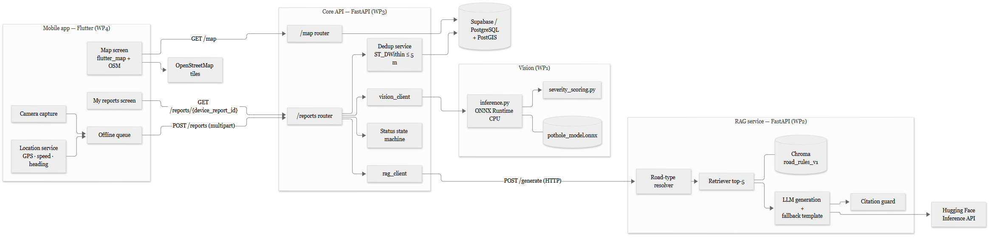

*Source: [`diagrams/src/architecture.mmd`](diagrams/src/architecture.mmd)*

### 8.2 Component diagram — provided and required interfaces

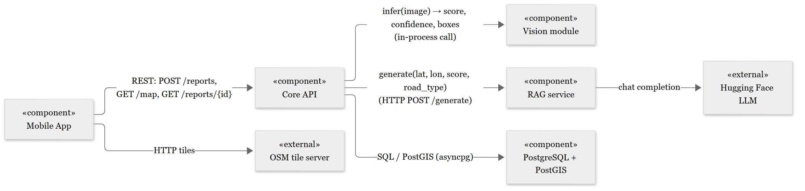

*Source: [`diagrams/src/component.mmd`](diagrams/src/component.mmd)*

### 8.3 Deployment diagram

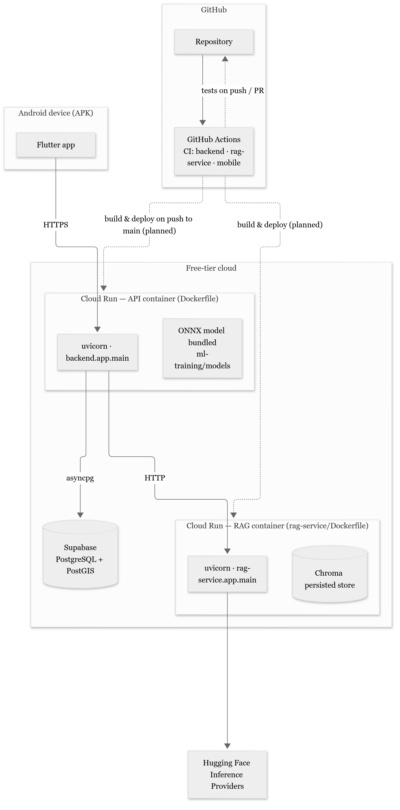

*Source: [`diagrams/src/deployment.mmd`](diagrams/src/deployment.mmd)*

**Local development** uses `docker-compose.yml` with three services — `db` (PostGIS 16), `api` and `rag-service` — plus persistent volumes for the database and the Chroma store.

> **Architecture decision AD-1 (Sprint 1).** The earlier versions of this specification packaged all services in one container. The repository instead ships **two Dockerfiles** (Core API + vision, and RAG) to keep PyTorch/Chroma out of the API image and its cold start. Vision remains an in-process call. This is recorded as decision AD-1 in Section 19.4.

---

## 9. Dynamic behaviour

### 9.1 Sequence — submitting a report (F1 + F2 + F3)

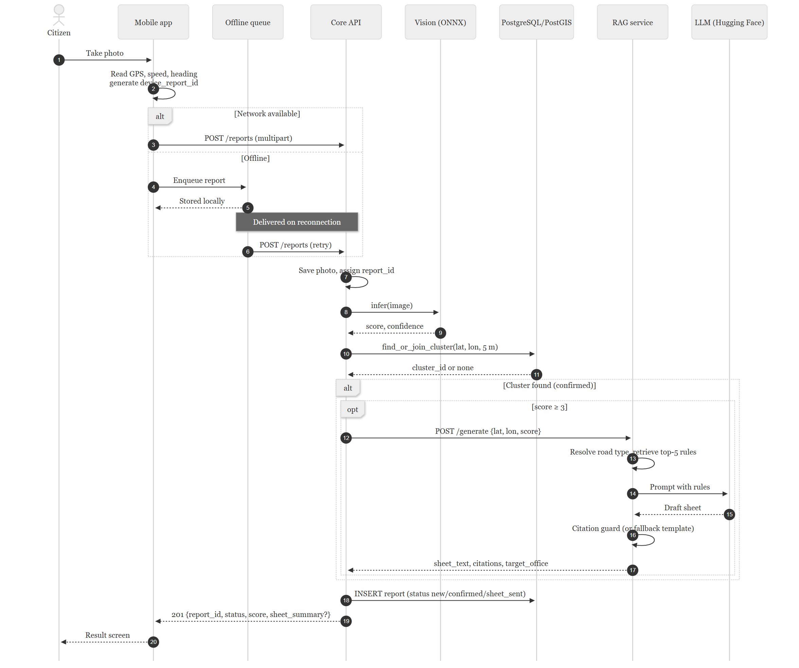

*Source: [`diagrams/src/seq_report.mmd`](diagrams/src/seq_report.mmd)*

### 9.2 Activity — report processing logic

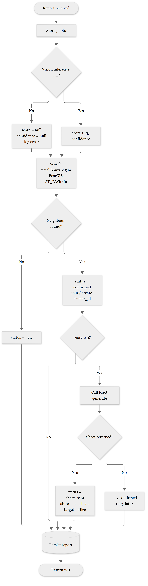

*Source: [`diagrams/src/activity_processing.mmd`](diagrams/src/activity_processing.mmd)*

### 9.3 State machine — report lifecycle

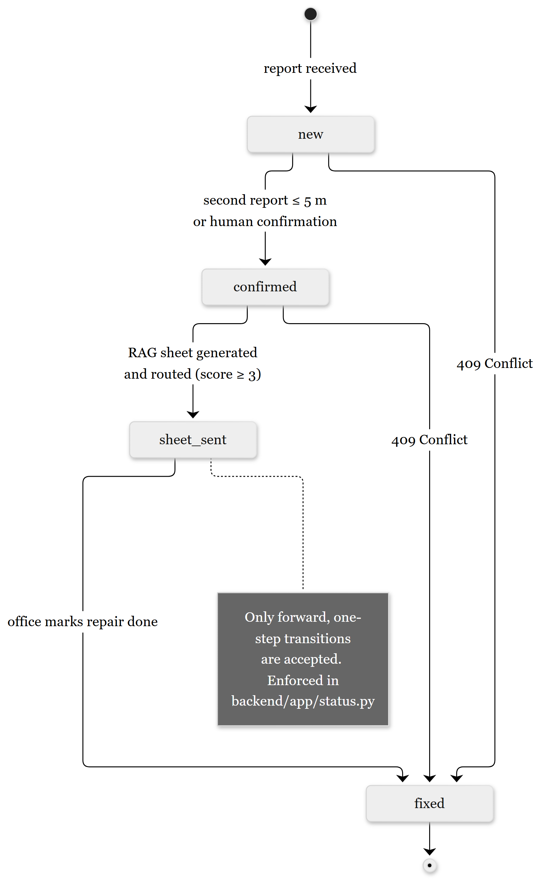

*Source: [`diagrams/src/state_lifecycle.mmd`](diagrams/src/state_lifecycle.mmd)*

### 9.4 Sequence — RAG work-sheet generation (internal)

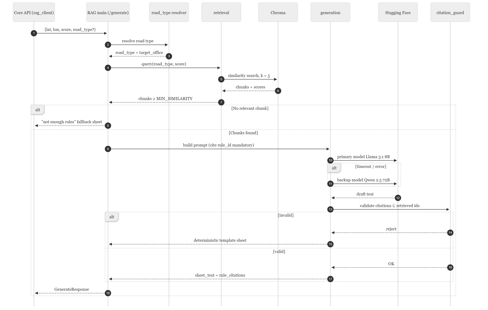

*Source: [`diagrams/src/seq_rag.mmd`](diagrams/src/seq_rag.mmd)*

### 9.5 Sequence — citizen tracks a report (F5)

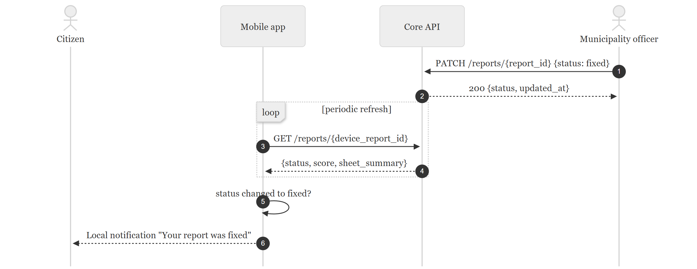

*Source: [`diagrams/src/seq_tracking.mmd`](diagrams/src/seq_tracking.mmd)*

### 9.6 Activity — driving mode (F6)

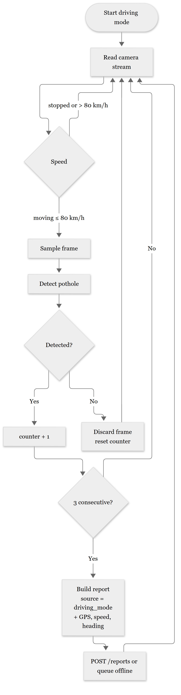

*Source: [`diagrams/src/activity_driving.mmd`](diagrams/src/activity_driving.mmd)*

---

## 10. Data model

### 10.1 Entity–relationship diagram

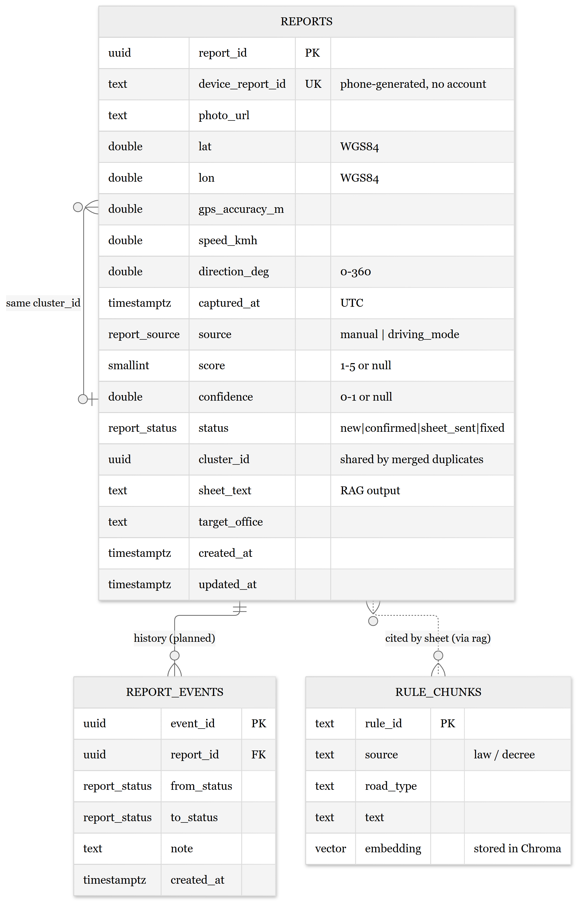

*Source: [`diagrams/src/er.mmd`](diagrams/src/er.mmd)*

> `REPORTS` is implemented in [`backend/app/db/schema.sql`](../backend/app/db/schema.sql) with a GiST index on the geography point (5 m search), and indexes on `status` and `cluster_id`. `REPORT_EVENTS` is planned to satisfy the audit-trail requirement (F4). `RULE_CHUNKS` lives in the Chroma collection `road_rules_v1`, not in PostgreSQL. `sheet_text` and `target_office` were added to `reports` (additive to the frozen contract) instead of a separate `sheets` table for the MVP.

### 10.2 Class diagram — backend domain

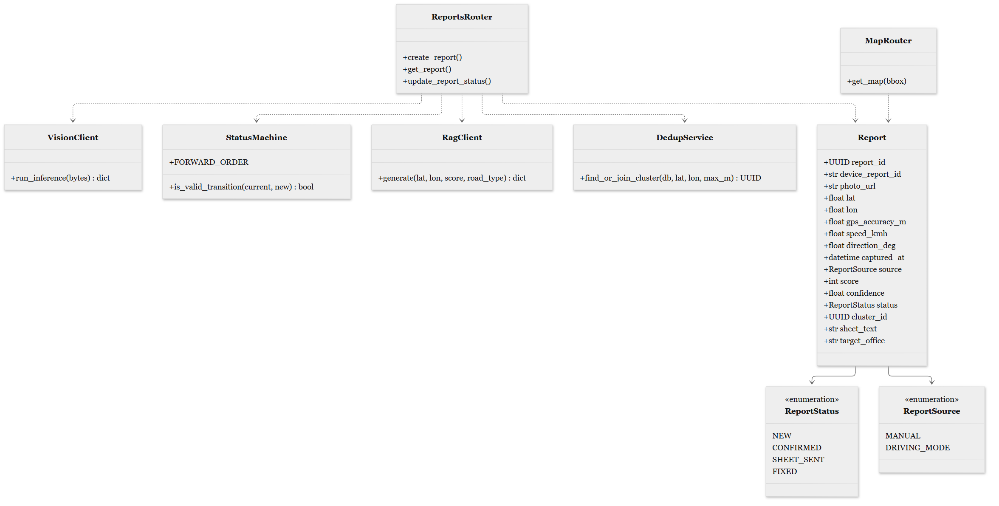

*Source: [`diagrams/src/class_backend.mmd`](diagrams/src/class_backend.mmd)*

### 10.3 Class diagram — mobile application

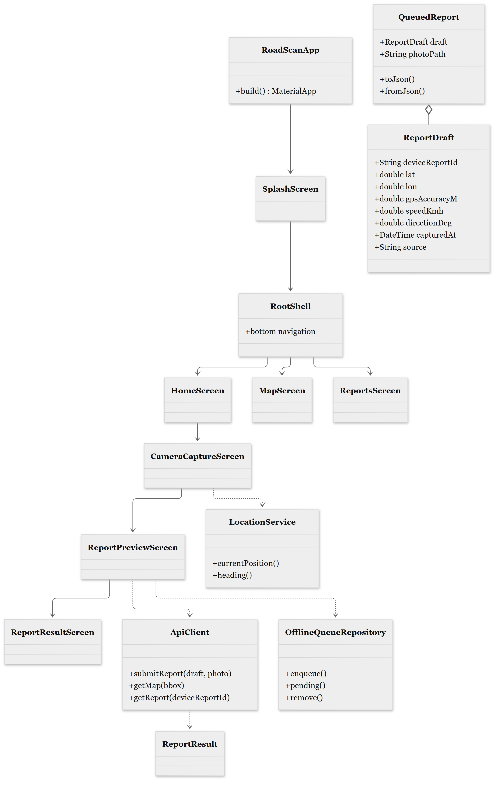

*Source: [`diagrams/src/class_mobile.mmd`](diagrams/src/class_mobile.mmd)*

---

## 11. Interface contracts

The following contracts are **frozen** (Sprint 1) and shared by every work package. A field may be added but never renamed or removed without unanimous agreement.

### 11.1 Report object

| Field | Type | Notes |
|---|---|---|
| `report_id` | UUID | Server-assigned only |
| `device_report_id` | string (UUID) | Generated on the phone, never reused |
| `photo_url` | string | Set by API; raw photo deleted after sheet creation |
| `lat`, `lon` | float | WGS84; latitude first |
| `gps_accuracy_m` | float | Used by deduplication |
| `speed_kmh` | float | 0 if stationary |
| `direction_deg` | float 0–360 | Compass heading |
| `captured_at` | ISO 8601 UTC with `Z` | No local time zones |
| `source` | enum | `manual` \| `driving_mode` |
| `score` | int 1–5 or null | From vision |
| `confidence` | float 0–1 or null | From vision |
| `status` | enum | `new` \| `confirmed` \| `sheet_sent` \| `fixed` |
| `cluster_id` | UUID or null | Shared among merged duplicates |
| `created_at`, `updated_at` | ISO 8601 UTC | Server-set |
| `sheet_text`, `target_office` | string or null | Additive: populated by RAG |

### 11.2 REST API

| Route | Purpose | Success | Errors | Status |
|---|---|---|---|---|
| `POST /reports` | Create a report (multipart: photo + fields) | `201` `{report_id, device_report_id, status, score, sheet_summary?, target_office?}` | `422` invalid input | ✅ |
| `GET /reports/{device_report_id}` | Status of a phone's own report | `200` `{report_id, status, score, sheet_summary?}` | `404` unknown id | ✅ |
| `PATCH /reports/{report_id}` | Move status forward | `200` `{report_id, status, updated_at}` | `404`, `409` non-forward | ✅ |
| `GET /map?bbox=minLon,minLat,maxLon,maxLat` | Points in viewport | `200` list of `{report_id, lat, lon, score, status, cluster_id}` | `422` bad bbox | ✅ |
| `GET /map?…&sev=&state=` | Filtered map | as above | | ⬜ |
| `GET /authorities/{id}/queue` | Sorted list for one office (F4) | `200` list | | ⬜ |
| `GET /export?format=geojson\|csv` | Download filtered data | file | | ⬜ |
| `GET /health` | Liveness | `200` | | ✅ |
| `GET /docs` | OpenAPI documentation (FastAPI) | HTML | | ✅ |

### 11.3 Vision interface (WP1 → WP3)

```text
infer(image: bytes) -> {
  "score": int,            # 1-5
  "confidence": float,     # 0-1
  "boxes": [ {x, y, w, h, class: "pothole"} ],
  "inference_ms": float
}
```

### 11.4 RAG interface (WP2 → WP3) — `POST /generate`

```text
Request : { lat: float, lon: float, score: int (1-5), road_type?: str }
Response: {
  sheet_text: str,
  rule_citations: [ { rule_id, source, excerpt } ],
  target_office: "Municipality" | "DGPC" | "Ministry of Equipment",
  road_type: "urbain_principal" | "urbain_secondaire" | "rural" | "autoroute" | "piste",
  generated_at: ISO-8601 UTC,
  generation_ms: float
}
```

`GET /health` on the RAG service returns `{status, chunks_indexed}`.

### 11.5 Shared configuration (`.env.example`)

| Variable | Owner | Meaning |
|---|---|---|
| `DATABASE_URL` | WP3 | PostgreSQL / PostGIS connection |
| `MODEL_PATH` | WP1 | Path to `pothole_model.onnx` |
| `CHROMA_DB_PATH` | WP2 | Chroma persistence directory |
| `HF_API_TOKEN`, `HF_MODEL_PRIMARY`, `HF_MODEL_BACKUP` | WP2 | LLM access and model choice |
| `RAG_SERVICE_URL`, `RAG_TIMEOUT_S` | WP3 | Where and how long the API waits for RAG |
| `MAX_DEDUP_DISTANCE_M` | WP3 | Deduplication radius (5) |
| `SCORE_THRESHOLD_FOR_SHEET` | WP3 / WP2 | Minimum score to generate a sheet (3) |
| `PORT`, `CLOUD_RUN_SERVICE_NAME` | WP-T | Deployment |

---

## 12. Work packages and repository structure

### 12.1 Work packages

| WP | Scope | Owner | Co-owner | Deliverable |
|---|---|---|---|---|
| **WP1** | AI detection model and severity rule | Tharaa Oueslati | Jasseur Chibani | `pothole_model.onnx`, `inference.py`, training pipeline, model report |
| **WP2** | RAG agent and work sheet | Aymen Jeddou | Jed Belhaj Mohamed | `rag-service/`, indexed rule corpus |
| **WP3** | Core API and geospatial backend | Jasseur Chibani | Tharaa Oueslati | FastAPI service, PostGIS schema, tests |
| **WP4** | Mobile app (citizen and driving mode) | Jed Belhaj Mohamed | Aymen Jeddou | Flutter app and APK |
| **WP-T** | Transversal: Docker, CI/CD, contracts | All | — | Dockerfiles, GitHub Actions, `.env.example`, docs |

### 12.2 Repository layout

```text
RoadScan/
├── README.md                     Project overview and Agile workflow
├── Dockerfile                    Core API image (+ ONNX model), two-stage build
├── docker-compose.yml            Local stack: db (PostGIS) · api · rag-service
├── .env.example                  Shared configuration (single source of truth)
├── .github/workflows/ci.yml      CI: backend · rag-service · mobile
│
├── docs/
│   ├── Cahier_de_charges.md      This document
│   └── Sprint1_Action_Plan.md    Sprint plan and frozen data contracts
│
├── mobile/                       WP4 — Flutter app
│   ├── lib/
│   │   ├── main.dart · config.dart
│   │   ├── app/                  roadscan_app.dart · brand.dart (theme)
│   │   ├── models/               report_draft · queued_report · report_result
│   │   ├── screens/              splash · root_shell · home · camera_capture ·
│   │   │                         report_preview · report_result · map · reports
│   │   ├── services/             api_client · location_service ·
│   │   │                         offline_queue_repository · mock_reports
│   │   └── utils/                iso8601.dart
│   ├── test/                     models · services · utils · widgets
│   ├── assets/fonts/             Readex Pro, Reem Kufi
│   └── design/                   UI mock-ups (main · map · reports)
│
├── backend/                      WP3 — Core API (+ WP1 runtime)
│   ├── app/
│   │   ├── main.py · config.py · db.py · db_models.py · schemas.py
│   │   ├── status.py             State machine
│   │   ├── dedup.py              PostGIS 5 m merge
│   │   ├── vision_client.py      In-process call to WP1
│   │   ├── rag_client.py         HTTP client to WP2
│   │   ├── routers/              reports.py · map.py
│   │   ├── db/schema.sql         PostgreSQL + PostGIS schema
│   │   ├── static/photos/        Uploaded photos (dev)
│   │   └── tests/                test_reports · test_map · test_status
│   └── vision/README.md          Pointer to the vision runtime
│
├── ml-training/                  WP1 — Model training and export
│   ├── train.py · convert_to_yolo.py · export_onnx.py
│   ├── inference.py              infer(image) -> {score, confidence, boxes}
│   ├── severity_scoring.py       Frozen severity rule (1–5)
│   ├── timing_test.py            CPU latency benchmark
│   ├── data.yaml · requirements.txt
│   └── models/pothole_model.onnx
│
└── rag-service/                  WP2 — RAG microservice
    ├── Dockerfile · requirements.txt · .env.example
    ├── app/
    │   ├── main.py               /generate · /health
    │   ├── pipeline.py           Orchestration
    │   ├── road_type.py · retrieval.py · embeddings.py
    │   ├── generation.py         LLM call + template fallback
    │   ├── citation_guard.py     Rejects invented citations
    │   └── config.py · schemas.py
    ├── ingestion/                chunker.py · build_index.py
    ├── rules_real/               Law 2018-29 (CCL), Law 86-17
    ├── rules_placeholder/        Interim rules per road type
    └── tests/                    test_citation_guard · test_pipeline_fallback
```

### 12.3 Package diagram — module dependencies

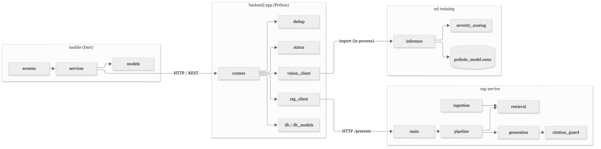

*Source: [`diagrams/src/package.mmd`](diagrams/src/package.mmd)*

### 12.4 Inter-WP dependency and handoffs

| From → To | Interface | Frozen shape |
|---|---|---|
| WP1 → WP3 | `run_inference(image)` | Section 11.3 |
| WP2 → WP3 | `POST /generate` | Section 11.4 |
| WP3 → WP4 | REST routes | Section 11.2 |
| WP-T → all | Container + config list | Sections 11.5, 15 |

---

## 13. Technology choices

Each decision states the constraint, the candidates evaluated (✓ satisfies, ✗ does not) and the selection.

### 13.1 Mobile framework — *one month, small team, Android + iPhone*

| Criterion | **Flutter** | React Native | Native ×2 |
|---|:-:|:-:|:-:|
| Single codebase | ✓ | ✓ | ✗ |
| Free, good map rendering | ✓ | ✗ | ✗ |
| Fast to learn in a month | ✓ | ✗ | ✗ |

**Selected: Flutter.** Packages in use: `camera`, `geolocator`, `flutter_compass`, `flutter_map` + `latlong2`, `http`, `shared_preferences` (offline queue persistence), `path_provider`, `uuid`.

### 13.2 Map base layer — *0 TND, covers Tunisia*

| Criterion | **OpenStreetMap** | Google Maps | Mapbox |
|---|:-:|:-:|:-:|
| No API key | ✓ | ✗ | ✗ |
| No usage cap | ✓ | ✗ | ✗ |
| Tunisia coverage | ✓ | ✓ | ✓ |

**Selected: OpenStreetMap.**

### 13.3 Detection model — *CPU only, < 250 ms*

| Criterion | **YOLOv8n** | YOLOv8s/m | Faster R-CNN |
|---|:-:|:-:|:-:|
| Fast on CPU | ✓ | ✗ | ✗ |
| Small file | ✓ | ✗ | ✗ |
| Sufficient accuracy | ✓ | ✓ | ✓ |

**Selected: YOLOv8n**, exported to **ONNX (opset 12)** and run with ONNX Runtime — light, portable, no PyTorch needed in production.

### 13.4 Vector store — *0 TND, 15–30 pages of rules*

| Criterion | **Chroma (local)** | Pinecone | Weaviate |
|---|:-:|:-:|:-:|
| Free, no extra account | ✓ | ✗ | ✗ |
| Runs beside the service | ✓ | ✗ | ✗ |
| Fast at this size | ✓ | ✓ | ✓ |

**Selected: Chroma**, collection `road_rules_v1`.

### 13.5 Embeddings — *French text, 0 TND*

| Criterion | **Multilingual SentenceTransformers** | OpenAI | Cohere |
|---|:-:|:-:|:-:|
| Free, local | ✓ | ✗ | ✗ |
| Handles French | ✓ | ✓ | ✓ |
| No per-request cost | ✓ | ✗ | ✗ |

**Selected:** `paraphrase-multilingual-MiniLM-L12-v2`.

### 13.6 Sheet-writing LLM — *0 TND, no GPU to host*

| Criterion | **Llama 3.1 / Qwen 2.5 (HF)** | GPT-4o | Claude |
|---|:-:|:-:|:-:|
| Free to call | ✓ | ✗ | ✗ |
| Open weights | ✓ | ✗ | ✗ |
| No monthly bill | ✓ | ✗ | ✗ |

**Selected:** Llama-3.1-8B-Instruct (primary, measured 4.5–7.6 s) with Qwen2.5-72B-Instruct as backup. Models such as Qwen2.5-7B and Llama-3.2-3B were tested and found unavailable through the enabled providers; availability must be re-verified before each demo.

### 13.7 API framework — *async uploads and AI calls*

| Criterion | **FastAPI** | Flask | Django REST |
|---|:-:|:-:|:-:|
| Async concurrency | ✓ | ✗ | ✗ |
| Auto API docs | ✓ | ✗ | ✓ |
| Automatic validation | ✓ | ✗ | ✓ |

**Selected: FastAPI** with SQLAlchemy (asyncio) and asyncpg.

### 13.8 Database — *"what is near this point?"*

| Criterion | **Supabase (PostGIS)** | MongoDB | Firebase |
|---|:-:|:-:|:-:|
| Native geospatial queries | ✓ | ✗ | ✗ |
| Large enough free tier | ✓ | ✓ | ✓ |
| Standard SQL | ✓ | ✗ | ✗ |

**Selected: PostgreSQL + PostGIS** (Supabase in production, `postgis/postgis:16` locally).

### 13.9 Compute — *0 TND, low idle traffic*

| Criterion | **Google Cloud Run** | VM | Kubernetes |
|---|:-:|:-:|:-:|
| Free when idle | ✓ | ✗ | ✗ |
| No server management | ✓ | ✗ | ✗ |
| Auto-scaling | ✓ | ✗ | ✓ |

**Selected: Cloud Run.**

### 13.10 CI/CD — *small team already on GitHub*

| Criterion | **GitHub Actions** | Jenkins | GitLab CI (self-hosted) |
|---|:-:|:-:|:-:|
| Free minutes | ✓ | ✗ | ✗ |
| Native to GitHub | ✓ | ✗ | ✗ |
| No server to maintain | ✓ | ✗ | ✗ |

**Selected: GitHub Actions.**

### 13.11 Service split — *keep the API image light*

| Criterion | **Separate RAG service** | RAG in the API process |
|---|:-:|:-:|
| API image without torch/chromadb | ✓ | ✗ |
| Fast API cold start | ✓ | ✗ |
| Single deploy unit | ✗ | ✓ |

**Selected: separate RAG service** (decision AD-1). Vision stays in-process because ONNX Runtime is light.

### 13.12 Driving-mode hardware

| Criterion | **Phone on windscreen** | Dedicated dashcam |
|---|:-:|:-:|
| No extra cost | ✓ | ✗ |
| Reuses app and model | ✓ | ✗ |
| Any volunteer can use it | ✓ | ✗ |

**Selected: phone on windscreen.**

### 13.13 Free-tier budget check (demo month)

| Service | Free limit / month | Expected use | Margin |
|---|---|---|---|
| Cloud Run — requests | 2,000,000 | ~15,000 | > 99 % |
| Cloud Run — compute | 180,000 vCPU·s | ~4,500 | ~97 % |
| Supabase — storage | 500 MB | < 50 MB | > 90 % |
| Hugging Face API | shared limit | ~500 sheets | mitigated by fallback |
| GitHub Actions | 2,000 min | ~200 min | ~90 % |

---

## 14. Data, privacy and legal compliance

### 14.1 Training data (WP1)

- Sources: free datasets (Roboflow, Kaggle) plus team photos and driving clips from Tunisia. Target 2,000+ images; Sprint 1 target ≥ 400 labelled.
- Split 70 / 15 / 15 **by geographic area**, not randomly, so the test set is fair.
- A single label, `pothole`. Severity is **derived** from the bounding box, not hand-labelled.
- Augmentation: blur, rain, shadow, brightness.
- Training: `ultralytics` YOLOv8n from pretrained weights; final run targets 60 epochs at `imgsz=640` (Sprint 1 pipeline verified with 1 epoch).

### 14.2 Rule corpus (WP2)

| Content | Source |
|---|---|
| Road classification | Law 86-17 |
| Competences of local authorities | Law 2018-29 (Code des Collectivités Locales) |
| Repair methods and standard values | Technical references (to be completed) |

Chunking is **semantic**: one chunk per article or clause; chunks above 300 words are split into ~200-word parts with ~35-word overlap and capped at 1,200 characters. Every chunk keeps title, section and source, and each generated sheet stores the list of chunks it used, so that faults are fixed in the rules, not in the model.

### 14.3 Personal data and privacy

- No name, phone number or account identifier is collected; a report is tied only to the phone's `device_report_id`.
- Faces and licence plates are blurred before a photo is persisted *(planned)*.
- Compliance with **Law 2004-63** on personal data; location data describes the road, not the person's trips.
- Raw photos are deleted once the sheet is produced *(planned)*; only summary data and the sheet remain.
- Driving mode discards empty frames on the device and never stores whole trips.

---

## 15. Quality assurance, CI/CD and deployment

### 15.1 Branching workflow

| Rule | Description |
|---|---|
| Protected branches | `main` (demo-ready) and `dev` (integration); no direct push |
| Feature branches | `feature/…`, `fix/…`, `chore/…` created from `dev` |
| Pull requests | Target `dev`; at least one review by another member; reference the issue (`Closes #n`) |
| Green CI | Mandatory before merge |
| Release | `dev → main` only at the end of a sprint once the Definition of Done is met |

### 15.2 CI pipeline

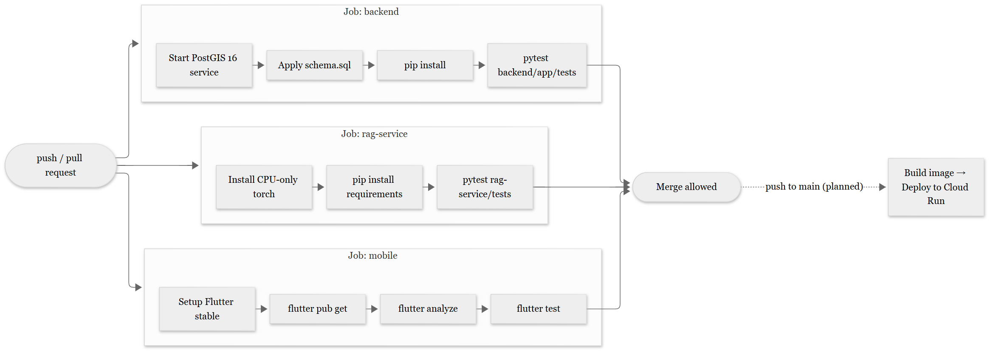

*Source: [`diagrams/src/ci_pipeline.mmd`](diagrams/src/ci_pipeline.mmd)*

### 15.3 Test strategy

| Level | Scope | Tooling | Status |
|---|---|---|---|
| Unit | Status transitions, GeoJSON/bbox parsing, dedup, citation guard, ISO 8601 helper, queue model | pytest, flutter_test | ✅ |
| Integration | API ↔ PostGIS ↔ mocked vision / RAG | pytest + pytest-asyncio + httpx | ✅ |
| Widget | Root navigation shell | flutter_test | ✅ |
| Model | mAP@50 and latency (`timing_test.py`) | ultralytics, ONNX Runtime | 🟡 |
| End-to-end | Phone → API → map → sheet | Manual on device | ⬜ |
| Load | Map with 5,000+ points | Synthetic data | ⬜ |

### 15.4 Deployment

1. **API image** — `Dockerfile` (two-stage, Python 3.12-slim). Bundles `backend/app` plus `ml-training/inference.py`, `severity_scoring.py` and the ONNX model. Listens on `$PORT`.
2. **RAG image** — `rag-service/Dockerfile`, Chroma store on a persistent volume.
3. **Keep-alive** — an external free pinger calls `GET /health` every 10 minutes before demos.
4. **Observability** — `/health` on both services, request logs, RAG generation time in each response.

---

## 16. Project plan

### 16.1 Sprint schedule

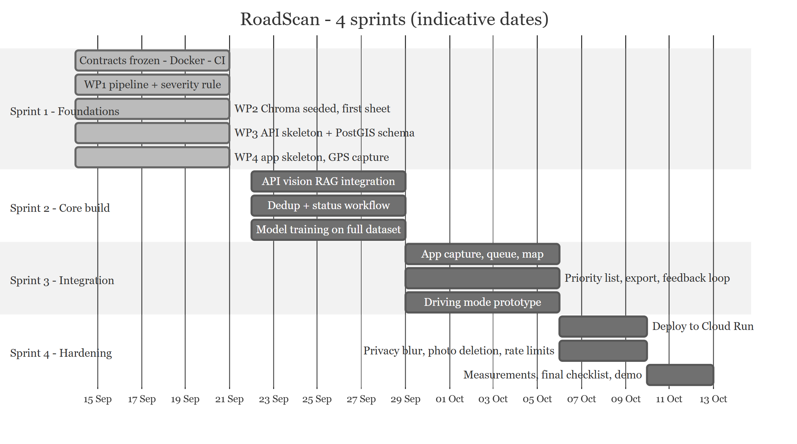

*Source: [`diagrams/src/gantt.mmd`](diagrams/src/gantt.mmd)*

### 16.2 Sprint goals and exit checks

| Sprint | Goal | Check before moving on |
|---|---|---|
| **1** | Runnable skeleton for every WP; contracts frozen | Everything runs end-to-end on mock data; one Dockerfile builds; CI green |
| **2** | Real pipeline: photo → score → dedup → sheet | A real photo produces a located, scored report; a confirmed serious pothole produces a sheet; mAP@50 ≥ 0.6 |
| **3** | Complete mobile flow and F4–F6 | Full flow on a phone: photo → dot on map → readable sheet; mAP@50 ≥ 0.75 |
| **4** | Hardening and demo | Every target of Section 2 measured; live demo on Cloud Run |

### 16.3 RACI

| Activity | Tharaa | Aymen | Jasseur | Jed |
|---|:-:|:-:|:-:|:-:|
| Dataset and training (WP1) | **R/A** | C | R | I |
| Severity rule | **R/A** | I | C | I |
| Rule corpus and RAG (WP2) | I | **R/A** | C | R |
| Core API and PostGIS (WP3) | R | I | **R/A** | I |
| Mobile app (WP4) | I | R | I | **R/A** |
| Docker / CI / contracts (WP-T) | R | R | R | R |

R = responsible · A = accountable · C = consulted · I = informed

---

## 17. Risk analysis

| # | Risk | Prob. | Impact | Mitigation |
|---|---|:-:|:-:|---|
| R1 | Not enough photos → low accuracy | Med | High | Collect from day 1, augment, start from pretrained weights |
| R2 | Hugging Face limit, latency or model removal | High | Med | Two models plus deterministic template; verify availability before demo; never block report creation |
| R3 | Cold start | High | Low | Keep-alive ping, loading indicator |
| R4 | Inaccurate urban GPS | High | Med | Use `gps_accuracy_m`, require 2 nearby reports, use heading |
| R5 | Blurry frames in driving mode | High | Med | Low frame rate, 3 consecutive frames, speed cap 80 km/h, blurred training photos |
| R6 | Privacy risk from continuous capture | Med | Med | Discard empty frames on device, blur faces/plates, no trip storage |
| R7 | Incomplete rule corpus | Med | Med | Small, explicit coverage; replace placeholders with real texts; sheets state when rules are insufficient |
| R8 | Free storage exhausted | Low | Med | Delete raw photos after sheet creation |
| R9 | Scope creep | High | Med | Section 4.2 is the boundary; new ideas go to a backlog |
| R10 | False positives (puddle, shadow) | Med | Med | Confidence threshold, 2-report confirmation, "not a pothole" training images |
| R11 | Contract drift between WPs | Med | High | Frozen contracts, shared `.env.example`, tests against exact field names |
| R12 | Synchronous RAG call slows `POST /reports` | Med | Med | Move to background task in Sprint 3; 15 s timeout with graceful fallback |

### Risk matrix (probability × impact)

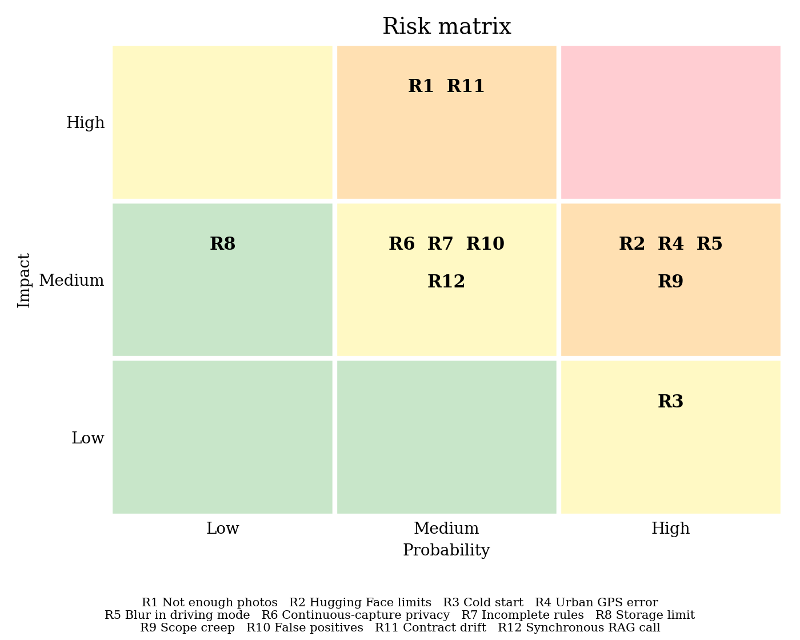

*Source: [`diagrams/src/risk_matrix.py`](diagrams/src/risk_matrix.py)*

---

## 18. Acceptance criteria

The MVP is accepted when all items below are demonstrated live to the team and supervisors.

| # | Criterion | Verification |
|---|---|---|
| 1 | A real photo becomes a coloured dot on the map in < 3 s (excluding sheet) | Stopwatch on device |
| 2 | A short drive with the phone on the windscreen produces at least one correct automatic report | Field test |
| 3 | The model reaches mAP@50 ≥ 0.75 on the test set, with a written report | Model report |
| 4 | A confirmed serious pothole produces a sheet citing a real rule and a non-empty target office | Inspect `sheet_text` and citations |
| 5 | The map shows, filters and deduplicates; deduplication runs in the database | Two reports < 5 m apart |
| 6 | The status flow `new → confirmed → sheet_sent → fixed` works and is logged | `PATCH` sequence including a rejected transition |
| 7 | Every push to `main` deploys to Cloud Run automatically | Actions run + live URL |
| 8 | Monthly infrastructure cost is 0 TND | Billing consoles |
| 9 | Repository contains code for all WPs, Dockerfiles, API docs, README, model report and this checklist | Repository review |

### Current implementation snapshot (end of Sprint 1 / start of Sprint 2)

| Area | Done | Remaining |
|---|---|---|
| WP1 Vision | Training/export pipeline, ONNX model, `inference.py`, severity rule, timing test | Full-scale training to reach 0.75 mAP, model report |
| WP2 RAG | Pipeline, retrieval, citation guard, fallback, real-law seeds, tests | Complete rule corpus, background integration |
| WP3 API | Reports/map/status routes, dedup, schema, tests, Dockerfile | `report_events`, queue/export routes, map filters, rate limiting, photo blur/deletion |
| WP4 Mobile | Screens, GPS/heading, offline-queue model and repository, tests | Queue flushing, real API wiring, notifications, clustering, driving mode |
| WP-T | Compose stack, CI on 3 jobs, `.env.example`, contracts | Cloud Run deploy workflow, keep-alive |

---

## 19. Appendices

### 19.1 Glossary

| Term | Definition |
|---|---|
| Baladiya | Tunisian municipality |
| DGPC | Direction Générale des Ponts et Chaussées |
| RAG | Retrieval-Augmented Generation: an LLM restricted to retrieved real text |
| mAP@50 | Mean average precision at IoU 0.5 — detection quality metric |
| ONNX | Open model exchange format for fast CPU inference |
| PostGIS | Geospatial extension of PostgreSQL |
| Cluster | Set of reports within 5 m considered the same pothole |
| Scale-to-zero | Service stops and costs nothing while idle |
| Cold start | Delay of the first request after idle |
| Dashcam mode | Phone on the windscreen detecting potholes while driving |

### 19.2 Road types

| Code | Type | Manager | Recipient of the sheet |
|---|---|---|---|
| `RN` | National road | DGPC / Ministry of Equipment | Regional office |
| `RR` | Regional road | DGPC / regional office | Regional office |
| `RL` | Classified local road | Regional office or city | Regional office or city |
| — | Unclassified city street | Baladiya | Municipal technical service |
| `A` | Motorway | Tunisie Autoroutes | Out of MVP scope |

The RAG service internally uses the road-type categories `urbain_principal`, `urbain_secondaire`, `rural`, `autoroute`, `piste`, mapped to the target offices `Municipality`, `DGPC` and `Ministry of Equipment`.

### 19.3 Compliance matrix — specification vs repository

| Specification element | Repository evidence | Status |
|---|---|---|
| Four components in separate folders | `mobile/`, `backend/`, `ml-training/`, `rag-service/` | ✅ |
| Contracts and enums (`manual` / `driving_mode`, four statuses) | `backend/app/schemas.py`, `status.py`, `schema.sql` | ✅ |
| 5 m PostGIS deduplication | `backend/app/dedup.py`, GiST index | ✅ |
| ONNX YOLOv8n, opset 12 | `ml-training/export_onnx.py`, `models/pothole_model.onnx` | ✅ |
| RAG with Chroma, top-5, citation guard | `rag-service/app/*` | ✅ |
| Two Dockerfiles + compose | `Dockerfile`, `rag-service/Dockerfile`, `docker-compose.yml` | ✅ |
| CI on backend, RAG and mobile | `.github/workflows/ci.yml` | ✅ |
| Cloud Run auto-deploy | — | ⬜ |
| `report_events`, `/authorities/{id}/queue`, `/export`, map filters | — | ⬜ |
| Face/plate blur, photo deletion, rate limiting | — | ⬜ |
| Driving mode, notifications, marker clustering | — | ⬜ |

### 19.4 Architecture decision records

| ID | Decision | Alternatives | Consequence |
|---|---|---|---|
| AD-1 | RAG is a separate HTTP service; vision stays an in-process call | Single container for all services | Lighter, faster-starting API image; two deployables |
| AD-2 | `source` values are `manual` and `driving_mode` | `citizen_photo` / `dashcam_frame` | Enum in DB and mobile follows the frozen contract |
| AD-3 | `sheet_text` and `target_office` stored on `reports` | Separate `sheets` table | Simpler MVP; can be normalised later |
| AD-4 | Severity computed from relative bounding-box area | Depth in mm | Depth is not measurable from a 2-D photo |
| AD-5 | Semantic (per-article) chunking with 1,200-character cap | Fixed 400-character windows | Preserves legal-clause integrity for citation |
| AD-6 | Offline queue persisted with `shared_preferences` | `hive` | Fewer dependencies; adequate queue volume |
| AD-7 | Primary LLM is Llama-3.1-8B-Instruct | Qwen2.5-72B primary | Meets the time budget (72B exceeded 12 s) |
| AD-8 | Frame rate of driving mode fixed after Sprint 3 test (target 1 fps) | 12 fps | Earlier versions were inconsistent (12 fps vs 1 fps) |

### 19.5 Open points

| # | Question | Owner | Due |
|---|---|---|---|
| OP-1 | Driving mode: on-device detection or server-side per frame? | WP1 / WP4 | Sprint 3 |
| OP-2 | Retry mechanism when RAG fails (background task vs scheduled job) | WP3 | Sprint 2 |
| OP-3 | Replace placeholder rules by validated legal/technical texts | WP2 | Sprint 2 |
| OP-4 | Definition of the "urgency × traffic × age" ordering formula and traffic source | WP3 | Sprint 3 |

---

<div align="center">

*RoadScan — Pothole Detection & Management System — MVP Tunisia*
*A. Jeddou · T. Oueslati · J. Chibani · J. Belhaj Mohamed — September 2026*

</div>
